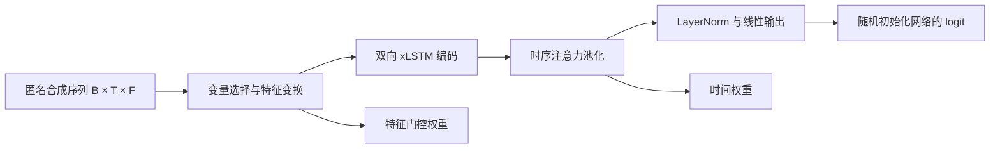

# 模型设计与公开边界

## 展示版的数据流

`model/components.py` 从研究项目中提取变量选择和池化组件，`model/xlstm.py` 提取实验版编码器，`model/demo_model.py` 重新组装为可独立运行的精简网络。

## 实现要点

1. **变量选择**：沿时间维求均值后生成独立 Sigmoid 门控，再进行特征变换与归一化。门控值不要求加和为 1，也不构成因果解释。
2. **时序编码**：使用本项目的 mLSTM / sLSTM 实验实现、局部卷积和残差连接；示例将前向与反向序列编码拼接。
3. **时序池化**：注意力分数叠加时间位置偏置，经 Softmax 得到时间权重，再对序列表示加权求和。
4. **可检查输出**：返回 logit、特征权重和时间权重，方便查看张量形状、数值范围和梯度。

双向编码使用的是给定观测窗口中的全部时间步。若迁移到真实预测，调用方必须保证整个输入窗口都早于预测时点；它不是逐时间步在线因果编码器。

## 与原研究工程的关系

原工程包含行情处理、标签生成、按商品分组的数据划分、训练集标准化与特征选择、模型训练、验证集温度校准和部署工件一致性校验等流程。展示版只公开通用模型组件，不包含这些业务流程的完整实现或训练结果。

当前可见训练流程按商品分组；这不等同于按时间向未来滚动验证。本作品集不声称已经证明未来收益、泛化效果或数据处理链完全无泄漏。

展示版不包括研究网络中的业务特征门控、真实特征名、标签阈值、标准化器、筛选列表或校准参数。示例中的 8 个特征、24 个时间步和 16 维隐藏状态是便于快速演示的配置，不是生产配置。

## 指标与结果

本版本只报告代码运行检查，不公布未经复核的准确率、F1、PR-AUC、收益或回测曲线。以后增加真实指标时，应同时交代数据期间、样本量、划分方式、基线、阈值选择方式以及指标口径。

## 参考与来源

- Beck et al. (2024), *xLSTM: Extended Long Short-Term Memory*, arXiv:2405.04517。
- 编码器来自本项目已有实验实现，不是论文作者的官方实现，也不声明严格复现论文。
- 公开展示前应核对项目原始代码来源及需要保留的第三方署名、许可文件。
